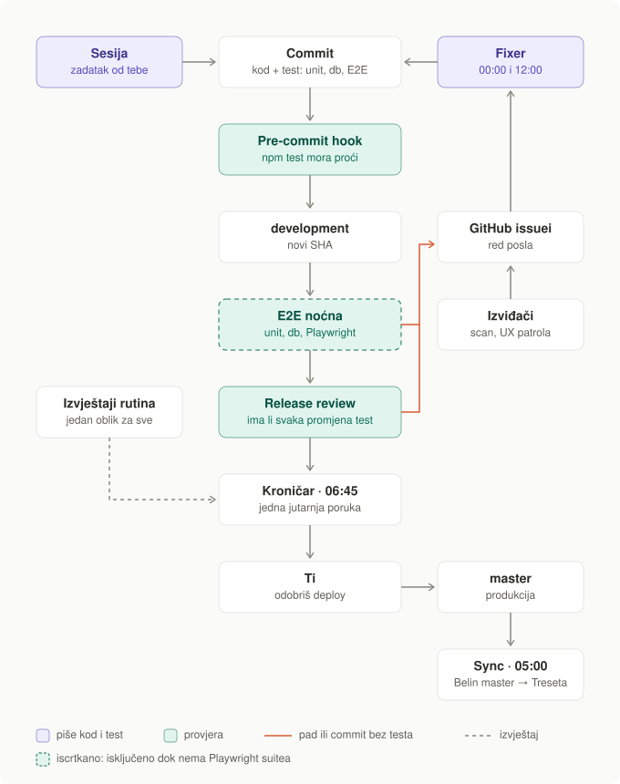
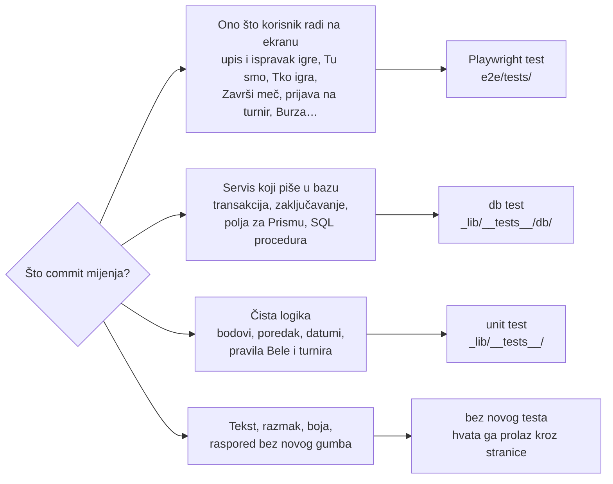

# Orkestracija agenata — glavni plan

Cilj: sesije i rutine rade kao jedan tim. Netko nađe problem, netko ga popravi s testom, netko provjeri i
pripremi deploy, a ti ujutro dobiješ **jednu poruku** s onim što čeka tebe. **Testove piše onaj tko piše kod, u
istom commitu**: unit, db ili Playwright, ovisno o tome što se mijenja (pogl. 5). Nijedna rutina ne piše testove
naknadno. Ovaj file je krovni plan. Detalji su u pomoćnim planovima.

## Kako ide

Sive strelice nose posao (commit, issue, SHA), narančaste pad testa ili commit bez testa, a isprekidana
izvještaje. E2E noćna je iscrtkana jer je isključena dok nema Playwright suitea, pa do tada fixer sam pokrene
release review, a release review sam klika. Promptovi rutina su u [`rutine/`](rutine/README.md), satnice u
pogl. 3, a koji test ide uz koji commit u pogl. 5. Stanje 15.11.

## 0. Dokumenti

| File | Čemu služi | Stanje |
| --- | --- | --- |
| `ORKESTRACIJA_AGENATA.md` | ovaj plan: tko je u timu, raspored, kako surađuju, faze | nacrt, 14.11. |
| [`E2E_PLAN.md`](E2E_PLAN.md) | Playwright testovi: compose, generirani podaci, popis testova, rutina, kako dodajemo testove (pogl. 9) | odluke od 14.11.; generator gotov |
| [`UNIT_PLAN.md`](UNIT_PLAN.md) | unit i db testovi: pravila, rupe, backlog | nacrt, 14.11. |
| skill `testovi` (`.claude/skills/testovi/SKILL.md`) | pravila **za agente**: koji test uz koju promjenu, kako se piše unit, db i Playwright test, red → green, kako se pokreće `test:db` | napravljen 15.11. |
| agent `e2e-reviewer` (`.claude/agents/`) | provjeri testove u diffu prema skillu; zovu ga sesija prije commita, fixer i release review | napravljen 15.11. |
| `.githooks/pre-commit` | `npm test` prije commita koji dira kod (~5 s) | napravljen 15.11., uključen u ovom checkoutu |
| [`rutine/`](rutine/README.md) | `README.md` (tim, zajednička pravila, labeli, brava, izvještaji), prompt svake rutine (lokalne i cloud) i graf `tok-rada.svg`; zadatak u aplikaciji i rutina na claude.ai samo kažu "pročitaj i slijedi" | napravljeno 15.11. |
| `e2e/FLOWS.md` *(novi, iz E2E_PLAN pogl. 9)* | tokovi igrača, organizatora i admina, uz svaki ime testa ili "nema" | faza E5 |

Planovi (`*_PLAN.md`, ovaj file) su za odluke i čitaš ih ti. Skill `testovi`, `CLAUDE.md` i `rutine/` su za agente:
kratki, zapovjedni, bez obrazloženja.

## 1. Kako je sada

**Tim danas**

| Rutina | Gdje | Kad (Zagreb) | Što radi | Izlaz |
| --- | --- | --- | --- | --- |
| `bela-github-issue-fixer` | laptop | 00:00 i 12:00 | uzme jedan otvoren issue po prioritetu, popravi ga u worktreeju, pusha na `development`, pokrene release review | poruka ≤ 7 redaka |
| `bela-release-review` | laptop | odmah iza fixera; rezerva 02:00 i 14:00 | pregleda `master..development`, popravi sitno, dump produkcije, test na kopiji, klika headless Chrome; deploy čeka tebe (scheduled run ne smije pushati na `master`) | poruka "30 sekundi" |
| `bela-nightly-sync` | laptop | 05:00 | Belini commitovi koji su došli na `master` (deployani) → Treseta na granu `bela-sync`, provjere na `bela-sync-pg`; od 15.11. ne uzima ništa što je samo na `development` | izvještaj |
| Bela app scan | cloud | pon. i čet. 07:00 | statički pregled koda | issue `auto-scan` |
| Bela mobile UX patrol | cloud | svaki dan 03:00 | gradi podatke klikanjem po mobitelu (390/360/375 px), gleda ekrane | do 5 issuea `mobile-ux-scan` |
| interaktivne sesije | laptop | po danu, više odjednom | kod, testovi po navici, commit na `development` | commitovi |

(`morning-repo-report` u 07:30 je Fansomnia, drugi projekt. Ovdje je samo zbog termina.)

**Zašto je razbacano** (konkretno)
1. **Drugi popravak čeka dan.** Release review ima guard "već pregledano danas", a fixer radi dvaput dnevno.
   Popravak iz 12:00 ne pregleda nitko do sutra, a rezerve u 02:00 i 14:00 nikad ne rade.
2. **Krivi redoslijed.** UX patrola (03:00) i scan (07:00) nalaze issuee nakon što je noćni fixer već završio, pa
   oni čekaju podne.
3. **Nema zajedničkih testova u lancu.** Release review svaki put iznova improvizira klikanje, `npm run test:db`
   se pokreće rijetko, a E2E još nema. Bugovi 1bb39ea (ispravak igre ne radi od 09.11., i na produkciji) i #74
   prošli su kroz sve rutine.
4. **Pet poruka, nijedna slika.** Svaka rutina piše svoj kraj, a nijedna ne kaže što od svega čeka tebe.
5. **Promptovi rutina nisu u repou.** Lokalni su u `~/.claude/scheduled-tasks/`, cloud u claude.ai. Ne
   verzioniraju se, ne pregledavaju se i razilaze se s memorijom (memorija još spominje label `FIX IT`, a fixer
   bira po prioritetu).
6. **Issue nema stanje.** Ne vidi se da fixer upravo radi na issueu, da je popravak na developmentu i čeka deploy,
   ni da issue čeka tvoj odgovor.
7. **Teški lokalni poslovi se mogu sudariti.** E2E stack, kopija produkcije u release reviewu i Podman u syncu
   nemaju zajedničku bravu.
8. **Testovi ovise o sesiji.** Pravila nisu zapisana. Od 15.10. testove dira 91 od 184 commita, a 59 od 147
   modula u `_lib` nijedan test ne uvozi izravno, od toga 48 servisa koji pišu u bazu (UNIT_PLAN pogl. 1).

## 2. Uloge

| Uloga | Tko | Što radi | Što nikad ne radi |
| --- | --- | --- | --- |
| **Autor** | interaktivne sesije | piše kod i **testove za njega** u istom commitu (unit, db ili Playwright, pogl. 5), jer zna namjeru | ne commita s crvenim `npm test` |
| **Izviđači** | scan (cloud), UX patrola (cloud), **E2E noćna** (laptop, nova), **zdravlje podataka** (`seed:verify --report` nad kopijom produkcije, samo u izvještaj) | nalaze probleme i otvaraju issue s izvorom, koracima i SHA-om | ne mijenjaju kod ni testove |
| **Popravljač** | `bela-github-issue-fixer` | jedan issue po prolazu, s testom koji je bez popravka crven | ne mijenja `expect` samo da test prođe |
| **Čuvar** | `bela-release-review` | pregleda kod i testove, čita E2E izvještaj za isti SHA, priprema deploy | ne pušta promjenu logike bez testa; ne deploya sam |
| **Sinkronizator** | `bela-nightly-sync` | samo deployani Belin kod (`master`) → Treseta | ne dira `master` ni Belu |
| **Kroničar** *(nova)* | `bela-jutarnji-izvjestaj` | ujutro skupi izvještaje svih rutina i GitHub u **jednu poruku** | ništa ne mijenja |

Rutine koja piše testove nema (odlučeno 15.11.). Fixer piše test samo za svoj popravak, kao svaki autor.

## 3. Raspored (prijedlog)

Noć je lanac: svaka rutina na kraju pokrene sljedeću (`run_scheduled_task`, kao fixer danas pokreće release
review), a satnice su samo rezerva ako lanac pukne.

| Kad | Tko | Što | Predaje |
| --- | --- | --- | --- |
| 00:30 | fixer | jedan issue → `development` | E2E noćnoj |
| ~01:00 | **E2E noćna** | na SHA-u s `origin/development`: `npm test`, `test:db`, Playwright suite na generiranom svijetu, smoke i `seed:verify --report` na kopiji produkcije | release reviewu |
| ~01:45 | release review | pregled; testovi su već prošli za taj SHA, pa ih ne ponavlja; priprema deploy | — |
| 03:00 | UX patrola (cloud) | ekrani na generiranom svijetu (`npm run seed:e2e`) | issuei |
| 05:00 | sync | Belin `master` → Treseta | — |
| 06:45 | **kroničar** | jedna poruka (niže) | — |
| 07:00 pon. i čet. | scan (cloud) | statički pregled | issuei |
| 12:00 | fixer | jedan issue (uzima i noćne nalaze) | E2E (podnevna) → release review |

**Promjene u odnosu na danas**
- **Guard release reviewa po SHA-u, a ne po datumu.** Pregled se ponavlja samo ako se `origin/development`
  pomaknuo od zadnjeg pregledanog SHA-a. Podnevni popravak tako ne čeka sutra.
- **Brava za teške lokalne poslove.** `backups/.rutina.lock` s imenom rutine i vremenom. Rutina koja nađe svježu
  bravu čeka do 20 minuta, a onda preskoči i to zapiše. Isto vrijedi za E2E stack, kopiju produkcije i sync.
- **Deploy i dalje odobravaš ti.** Kroničar ujutro pita jedno pitanje: "Deploy `<sha>` (N promjena, svi testovi
  zeleni)?"
- **Laptop** mora biti budan od 00:30 do 07:00 (keep-awake), s upaljenom Claude aplikacijom i Podman VM-om.

**Jutarnja poruka kroničara** (najviše ~10 redaka)
1. **Čeka tebe:** deploy `<sha>`, pitanja iz issuea `treba korisnika`, ⏸ iz rutina.
2. **Noćas:** što je popravljeno (issue → commit), testovi (zeleno/crveno, novi flaky), sync Treseta.
3. **Novo:** issuei po izvoru (scan, UX, e2e, podaci) s prioritetom.
4. **Zdravlje:** `seed:verify --report` na kopiji produkcije, samo kad se nešto promijenilo od jučer.

## 4. Kako surađuju (ugovori)

**a) GitHub issuei su red posla.** Labeli koji postoje (`type:`, `priority:`, `effort:`, `area:`) ostaju, a
dodaju se:
- **izvor:** `auto-scan`, `mobile-ux-scan` (postoje); `e2e`, `flaky` (novi); `user` (ti, ručno);
- **stanje:** `fixer-radi` (fixer ga uzeo, pa ga nitko drugi ne dira), `na-developmentu` (popravljeno, čeka
  deploy; zatvara ga release review kad deploya, preko "Fixes #N" u commitu), `treba-korisnika` (pitanje za
  tebe; fixer ga preskače dok ne odgovoriš).

Svaki izviđač prije otvaranja pretraži otvorene i zatvorene issuee (zatvorene već danas), pa isti problem ne
dolazi dvaput iz dva izvora.

**b) Izvještaji.** Svaka rutina piše `reports/rutine/<YYYY-MM-DD>/<rutina>.md`, lokalno i gitignored, u istom
obliku:
- prvi red: ✅ / ⏸ / ❌, SHA i jedna rečenica;
- što je napravila (issue, commit, test);
- što čeka tebe.

Kroničar čita samo to, plus GitHub. Krajnja poruka svake rutine ostaje kratka kao danas.

**c) Predaja.** Rutina predaje SHA na kojem je radila. Sljedeća radi na istom SHA-u ili kaže zašto ne (novi
commit u međuvremenu).

**d) Promptovi u repou.** `rutine/<id>.md` je izvor istine. Lokalni `SKILL.md` postaje dva retka: "Pročitaj
`rutine/<id>.md` s `origin/development` i slijedi ga". Cloud rutine klonaju repo pa čitaju isto. Promjena rutine
je commit, koji release review pregleda kao kod. `rutine/README.md` je ova tablica uloga i rasporeda za agente.

**e) Zajednička pravila.** `CLAUDE.md` ostaje kratak i upućuje na skill `testovi`. Rutine i dalje čitaju memoriju.
Ono što svaka rutina danas sama ponavlja (sandbox, `gh` REST, worktree, ne diraj `master`) seli se u
`rutine/README.md`, jednom.

## 5. Testovi u timu

- **Tko piše:** autor promjene, u istom commitu, jer zna što je kod trebao raditi. Agent koji dođe poslije vidi
  samo što kod radi, pa test može potvrditi i bug. Zato nema rutine koja naknadno dopisuje testove (odlučeno
  15.11.).

**Koji test** ovisi o tome što commit mijenja:

- **Često su dva.** Promjena toka koja mijenja i pravilo nosi unit test za pravilo i Playwright test za tok.
- **Ispravak buga:** test na najnižoj razini koja ga hvata, crven bez popravka. 1bb39ea je db test (Prisma je
  odbila polje), a #74 (drugi dodir na Završi meč) Playwright, jer je bug između ekrana i poslužitelja.
- **Playwright testovi kreću kad je suite složen** (E2E faze 1–4). Do tada promjena toka nosi unit ili db test.

**Ostalo**
- **Početni dug** pišu sesije planski, kao zasebne commitove po fazama: glavni tokovi A, B, C1–C9 (E2E_PLAN
  pogl. 5) i backlog P1–P4 (UNIT_PLAN pogl. 4). To nije rutina, nego zadaci koje ti pokreneš.
- **Pravilo** (CLAUDE.md, 3 retka, pa skill `testovi`):
  - commit koji mijenja ponašanje logike ili toka nosi novi ili izmijenjeni test, prema grafu iznad;
  - ispravak buga ima test koji bez popravka pada;
  - prije commita prolaze `npm test` i `tsc`.
- **Git hook** `pre-commit` u repou (`.githooks/`, `core.hooksPath`) pokrene `npm test` (2 s) i zaustavi commit
  koji ga ruši. Vrijedi za svaku sesiju i rutinu jer je u gitu, a ne u postavkama Claudea. Hook ne može natjerati
  da se test napiše; za to služe pravilo i čuvar.
- **Čuvar provjerava:** release review za svaki commit koji mijenja logiku ili tok traži test prave vrste, a bez
  njega nema deploya. Commit bez testa postaje issue sa SHA-om, pa test dopiše fixer ili sesija, kao za svaki
  drugi issue.
- **Pokrivenost se mjeri, ne forsira.** Noćni izvještaj pokaže module bez testa, API rute i stranice koje nijedan
  E2E test ne dotakne. Nema praga u postocima. Rupe idu u jutarnju poruku, a ti odlučiš koja postaje zadatak.

## 6. Faze

| Faza | Što | Gotovo kad |
| --- | --- | --- |
| **O1 Temelj** | ~~skill `testovi`; agent `e2e-reviewer`; pravilo u `CLAUDE.md`; `pre-commit` hook; fixer i release review po skillu; promptovi lokalnih rutina u `rutine/`; novi labeli; cloud rutine u `rutine/`~~ (15.11.) | sesija bez upute napiše test uz promjenu logike; rutine čitaju prompt iz repoa |
| **U1–U2** | `test:db` u noćnom pokretanju, izvještaj pokrivenosti, P1 db testovi (UNIT_PLAN) | `test:db` svaku noć zelen; P1 pokriven |
| **E1–E4** | compose, prolaz kroz stranice, dozvole, C1–C9 (E2E_PLAN faze 1–4) | C1 (ligaška večer) zelen `--repeat-each=5` |
| **O2 Tim** | ~~guard po SHA-u; brava; kroničar; stanja issuea; lanac fixer → (E2E) → release review~~ (15.11.); E2E noćna se uključuje s E5 | jedna noć bez tvoje intervencije, jedna jutarnja poruka |
| **E5** | E2E rutina, release review čita E2E izvještaj, UX patrola na generatoru, `FLOWS.md` | release review više ne klika sam |

Redoslijed: O1 prvi, jer je jeftin, a od sutra vrijedi za sve sesije. Zatim C1 iz E2E plana, jer bi uhvatio oba
zadnja buga. Zatim tim (O2).

## 7. Gotovo do sada (14.–15.11.)

- Generator testnih podataka (na `development` od 15.11., 9642282; UX patrola radi na njemu): `e2e/seed/`, `npm run seed:e2e` (svijet oblika produkcije za ~10 s, isti za isti
  seed) i `npm run seed:verify` (16 pravila).
- Podman VM ima 12 GB. Testna baza je `bela-e2e-pg` (Postgres 17 kao produkcija) na 55432.
- Odluke u E2E planu: jedna veličina podataka; kako dodajemo testove (pogl. 9).
- Odlučeno 15.11.: **nema rutine koja piše testove.** Testove piše autor, u istom commitu: unit, db ili
  Playwright (pogl. 5).
- `seed:verify --report` na kopiji produkcije: 53 igre sa zvanjima koja ne odgovaraju bodovima, 3 meča čiji
  rezultat nije zbroj igara, 166 mečeva bez igara koji nisu ni bye ni nedolazak, 10 zatvorenih stolova s krivim
  brojem mečeva. Ništa nije diran; zapisano samo ovdje, bez issuea (pogl. 8).

- 15.11., na `development`: skill `testovi`, agent `e2e-reviewer`, pravilo u `CLAUDE.md`, hook `.githooks/pre-commit`
  (`core.hooksPath` uključen u ovom checkoutu), `npm run test:db:local`, `.gitignore` pušta `.claude/agents/` i `.claude/skills/testovi/` u git.
- 15.11., rutine (izvan repoa, odmah na snazi): **fixer** piše test po skillu, crven → zelen, popravlja issue `e2e`,
  preskače `treba-korisnika`; **release review** ima guard po SHA-u, traži test uz svaku promjenu (bez njega issue,
  ne deploy), vrti `test:db` svaki put, čita E2E izvještaj kad postoji; **sync** čita Belin `master`.

## 8. Odluke koje čekaju tebe

1. **Deploy:** ostaje tvoje jutarnje odobrenje (danas ga ionako traži dozvola).
2. **Stari dokumenti:** `PLAN.md`, `REFINEMENTS.md`, `BACKEND_REVIEW.md`, `BLOCKERS.md`, `TEST_REPORT.md`
   (4.10.), `ProcessFlow.md`, `Task.md` i `.windsurfrules` su zastarjeli. Prijedlog: premjestiti ih u
   `docs/arhiva/`, a u `README.md` (iz 2024.) dodati kratku kartu dokumenata.

Riješeno 15.11.: noćni lanac fixer → (E2E) → release review, guard po SHA-u, git hook u repou, izvještaji rutina
lokalno i gitignored, promptovi rutina u `rutine/`. **Bez labela i issuea `data-health`:** provjera podataka na
kopiji produkcije ide samo u E2E izvještaj, a jutarnja poruka javlja kad je nešto novo.
